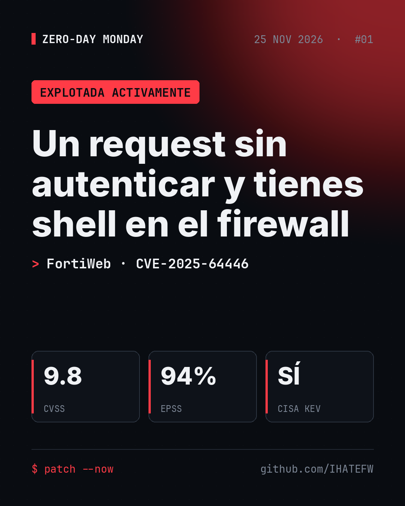

# ⚡ Zero-Day Monday

Todos los lunes a las **07:30 (hora de Chile)** este repo busca qué pasó de verdad en seguridad ofensiva durante la semana, elige **una** noticia que valga la pena y la publica en mi LinkedIn, escrita en primera persona y con una imagen hecha para el feed.

Nada de ISO, gobernanza ni leyes: bugs explotados, RCE sin autenticación, brechas reales, supply chain e IA ofensiva.

<p align="center"></p>

---

## Cómo decide qué publicar

```
 27 feeds + 6 APIs ──► agrupar ──► puntuar ──► shortlist (18) ──► editor IA ──► post + imagen ──► LinkedIn
                                                                                                     └─► link en el 1er comentario
```

**1. Recolección.** Prioriza fuentes de primera mano en lugar de medios que repiten la misma nota:

| Tipo | Fuentes |
|---|---|
| Investigación ofensiva | watchTowr Labs, Horizon3.ai, Google Project Zero, PortSwigger Research, Assetnote, Wiz Research, ZDI, Trail of Bits, Rapid7, Check Point Research, Unit 42, Talos, Huntress |
| Supply chain | Socket, StepSecurity, Aikido |
| IA ofensiva | Embrace The Red, Simon Willison (prompt injection) |
| Divulgación cruda | oss-security, Exploit-DB, GitHub Security Advisories (críticos) |
| Señales duras | **CISA KEV** (explotación confirmada), **EPSS** (probabilidad de explotación), **NVD** (CVSS), **Have I Been Pwned** (brechas nuevas), **Hacker News** (tracción en la comunidad técnica) |
| Medios (para medir cobertura) | BleepingComputer, The Hacker News, The Record, SecurityWeek, Krebs, DataBreaches.net, SANS ISC |

**2. Agrupación.** La misma historia contada por 6 sitios se junta en una sola (por CVE, por producto en KEV o por similitud del título). Que mucha gente seria hable de algo es una señal en sí.

**3. Puntuación heurística** (`zdm/score.py`), antes de gastar un solo token:
- `+` está en CISA KEV, EPSS alto, CVSS ≥ 9, ransomware asociado
- `+` pre-auth, RCE, 0-day, explotado in-the-wild, PoC público, backdoor, supply chain, prompt injection
- `+` cobertura en varias fuentes, puntos en Hacker News, millones de registros filtrados
- `−` gobernanza, cumplimiento, leyes, webinars, rondas de inversión, lanzamientos de productos, resúmenes semanales
- `−` antigüedad; `−100` si ya lo publiqué antes

**4. Editor IA** (`zdm/writer.py`). Claude recibe la shortlist con el **texto completo** de los mejores artículos y las señales, elige la noticia que un pentester senior consideraría la más importante y escribe el post siguiendo [`config/style.md`](config/style.md). La salida es JSON validado por esquema: no hay que parsear texto libre.

**5. Imagen** (`zdm/card.py`). Tarjeta tipográfica 1080×1350 (formato vertical, ocupa más feed) con titular, CVE y datos duros (CVSS / EPSS / KEV). Texto nítido, sin arte IA genérico.

**6. Publicación** (`zdm/linkedin.py`). API REST actual de LinkedIn (Posts + Images). Las fuentes van en el **primer comentario**, porque LinkedIn reduce el alcance de los posts con links.

### Lo que lo diferencia de [linkedin-post-automation](https://github.com/jaraneda666/linkedin-post-automation)

| | linkedin-post-automation | Zero-Day Monday |
|---|---|---|
| Infraestructura | n8n (servidor propio o de pago) + Google Sheets + Drive + Gmail | Solo GitHub Actions (gratis); el historial vive en el repo |
| Fuentes | 23 RSS mixtos (incluye hardware, blogs de Docker/HashiCorp, noticias generales) | Labs ofensivos de primera mano + KEV/EPSS/NVD/HIBP/HN |
| Selección | La primera noticia nueva que no se haya publicado | Ranking por explotación real, tipo de bug y cobertura cruzada; después decide un editor IA |
| Contexto para escribir | Título + resumen del RSS | Artículo completo + señales (KEV, EPSS, CVSS, fuentes) |
| Post | Bilingüe ES+EN, hasta ~2.200 caracteres | Un idioma, ≤1.300 caracteres, gancho pensado para el corte de "ver más" |
| Imagen | FLUX/Stable Diffusion: ilustración genérica | Tarjeta con datos duros, legible en el celular |
| Links | En el cuerpo del post | En el primer comentario |
| Voz | Prompt fijo dentro del workflow | `config/style.md` editable, primera persona, lista de muletillas de IA prohibidas |
| Horario | Hora fija del servidor | 07:30 en `America/Santiago`, con el cambio de horario resuelto |

---

## Puesta en marcha

### 1. App de LinkedIn
1. Crea una app en <https://www.linkedin.com/developers/apps> (te pide asociarla a una página de empresa; sirve una tuya cualquiera).
2. En **Products** agrega **Share on LinkedIn** y **Sign In with LinkedIn using OpenID Connect**.
3. En **Auth → Authorized redirect URLs** agrega `http://localhost:8765/callback`.
4. Copia el *Client ID* y el *Client Secret*.

### 2. Token de LinkedIn (dura 60 días)
```bash
pip install requests
export LINKEDIN_CLIENT_ID=xxx LINKEDIN_CLIENT_SECRET=yyy
python scripts/linkedin_auth.py
```
El script abre el navegador, obtiene el token y tu URN, y los guarda solo en los **secrets** del repo con `gh`. Cuando falten menos de 10 días para que venza, el workflow abre un *issue* para avisarte.

### 3. API key de Anthropic
Crea una key en <https://console.anthropic.com> y guárdala:
```bash
gh secret set ANTHROPIC_API_KEY
```
Costo aproximado: unos USD 0,15 por post (≈ USD 0,60 al mes).

Opcional: `gh secret set NVD_API_KEY` ([gratis](https://nvd.nist.gov/developers/request-an-api-key)) para que las consultas de CVSS no tengan que esperar el límite de tasa.

### 4. Probar
En **Actions → Zero-Day Monday → Run workflow**:
- `candidates`: muestra el ranking de la semana (no usa IA ni publica).
- `dry-run`: genera el post y la imagen; los dejo en el resumen del job y como artefacto descargable. **No publica.**
- `publish`: publica en ese momento.

Después de eso, corre solo todos los lunes.

### Local
```bash
python -m venv .venv && . .venv/bin/activate
pip install -r requirements.txt
python -m zdm candidates          # ranking de la semana
python -m zdm run --dry-run       # necesita ANTHROPIC_API_KEY; deja todo en posts/AAAA-MM-DD/
python -m zdm card-demo           # regenera assets/example-card.png
```

---

## Personalizar

| Quiero... | Archivo |
|---|---|
| Cambiar cómo sueno, qué temas evito y la estructura del post | `config/style.md` |
| Agregar o quitar fuentes, o subir el peso de alguna | `config/sources.yaml` |
| Zona horaria, largo del post, hashtags, links en el comentario, modelo | `config/settings.yaml` |
| Ajustar qué palabras suman o restan puntos | `zdm/score.py` (`BOOSTS` / `PENALTIES`) |
| Cambiar el diseño de la imagen | `zdm/card.py` |

Cada post publicado queda en `posts/AAAA-MM-DD/` (texto, imagen y metadatos) y en `data/history.json`, que también sirve para no repetir temas.

## Notas
- **Puntualidad:** GitHub Actions puede atrasar los cron unos minutos (a veces 15-30) en horas de mucha carga. Si necesitas 07:30 exacto, programa en [cron-job.org](https://cron-job.org) una llamada al endpoint `workflow_dispatch` con `mode=publish`.
- **Repos inactivos:** GitHub pausa los workflows programados después de 60 días sin actividad. Como cada publicación hace un commit, eso no debería pasar.
- **Contenido de terceros:** los artículos se pasan al modelo como datos, con instrucciones explícitas de no seguir nada de lo que digan (por si algún artículo trae una prompt injection).
- **Si algo falla:** si no se puede subir la imagen, igual publica solo el texto; si falla la publicación, el job queda en rojo y GitHub te manda un correo.

## Licencia
MIT. Fuentes tipográficas: Inter y JetBrains Mono (SIL Open Font License, en `assets/fonts/`).
